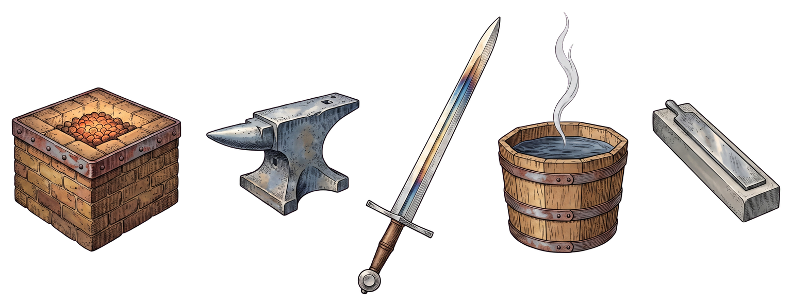
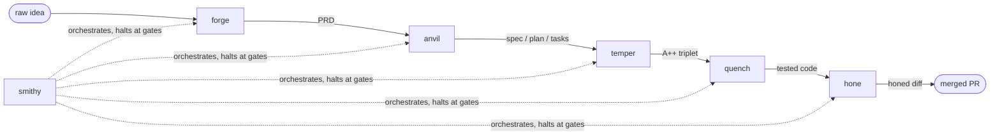

# Damascus

**Structured Prompt-Driven Development, or BDD/TDD carnival, or Spec-it-to-death.** A raw idea enters; folded, hardened, tested steel leaves.

Damascus is a set of agent skills that take a feature from idea to merge-ready code through five gated stages: a PRD, a spec, an adversarially reviewed plan, test-first implementation, and an adversarially reviewed diff. You vendor it into your repo as a submodule, `install.sh` links the skills into your agent harness (Claude Code's `.claude/`, plus `.agents/` and `.gemini/`), and every stage writes its state to plain files you can read, review and resume from.



<sub>Left to right: **forge** · **anvil** · **temper** · **quench** · **hone**.</sub>

## Quick start

From your repo root, pinning a release tag (see [Releases](https://github.com/forkrul/damascus_development/releases) for the latest):

```bash
git submodule add https://github.com/forkrul/damascus_development.git vendor/damascus
git -C vendor/damascus checkout v0.1.1                          # pin a release, never a moving branch
git -C vendor/damascus submodule update --init --recursive      # damascus's own pinned submodules
./vendor/damascus/install.sh
git add .gitmodules vendor/damascus && git commit -m "chore: vendor damascus v0.1.1"
```

Then, in an agent session in that repo, start a feature with the orchestrator — in Claude Code, `/smithy` (or its alias `/spdd-pipeline`), or just say "let's build *feature X*" and ask for the smithy skill. Smithy runs the next stage, halts at every gate for your signoff, and picks up where it left off on `smithy --resume`. To see what a finished run looks like before starting one, read [`examples/`](examples/): one feature's complete artifact trail through all five gates.

For one-line typos and hotfixes, skip the pipeline and just fix it — SPDD is for non-trivial work.

## The pipeline

| Stage | Skill | Alias | Input | Output |
|-------|-------|-------|-------|--------|
| 1 | `forge` | `prd-authoring` | raw idea | `.prd/NNN_<slug>.md` (REASONS Canvas PRD) |
| 2 | `anvil` | `speckit-decomposition` | PRD | `specs/NNN-<slug>/{spec,plan,tasks}.md` |
| 3 | `temper` | `adversarial-review-loop` | spec triplet | `review.md` with A++ rating |
| 4 | `quench` | `bdd-tdd-execution` | A++ triplet | gated tests + implementation + `quench-log.md` |
| 5 | `hone` | `code-review-loop` | green diff | `code-review.md` with A++ rating |
| ⊕ | `smithy` | `spdd-pipeline` | (any state) | drives all 5 stages, halting at every gate |



**Golden Rule (Fowler):** when reality diverges from the prompt, fix the prompt before the code.

Every gate message leads with what needs your decision (waivers, rejected or open findings, unconfirmed assumptions); between gates a stage keeps working instead of stopping to report. State lives in the disk artifacts, so smithy is stateless and can resume any feature from any point.

### Which stage do I start at?

Smithy decides from what is on disk, and you can too:

| You have | Start with |
|----------|------------|
| a raw idea, nothing written | `forge` |
| a PRD (all 7 REASONS sections filled) | `anvil` |
| `spec.md` + `plan.md` + `tasks.md` | `temper` |
| `review.md` ending in A++ | `quench` |
| every task checked and green in `quench-log.md` | `hone` |
| any of the above, unsure which | `smithy --resume` |

## How the gates hold

**Adversarial review (temper and hone).** Each round, three critic subagents with distinct lenses try to *refute* the artifact, and a judge dedupes their findings and rates the round. Blocking findings are applied, the round is logged, and the loop repeats. **A++ requires two consecutive rounds with zero blocking findings.** If at least four distinct blocking findings were raised and under 25 % of them by two or more critics, more defects probably remain, so the round is capped at B+; nits never cap a round. A suspicion a critic can't demonstrate is logged UNCONFIRMED and checked next round. The critics and judge are the session's own subagents — no API key or network access is needed — and `damascus agent-run` can optionally route them to other models, stripping model and provider names so the judge rates findings blind.

- **Temper** reviews the spec triplet (completeness, feasibility, testability & non-vacuity; at most 5 rounds). Critics attach evidence — re-derived sections, traced data flows, per-FR test skeletons, per-SC vacuity falsifiers; opinions without evidence are discarded. Trail: `specs/NNN-<slug>/review.md`.
- **Hone** reviews the implementation diff (spec conformance, security, simplicity; at most 3 rounds) in units of at most 400 changed lines. Every blocking finding comes with a repro, fixes never touch tests, and each fix is shown to fail without itself: `damascus revert-proof` reverts it in an isolated worktree and must see the guarding test go RED (not GREEN, and not an INCONCLUSIVE import error), and `damascus proof-coverage` checks that every changed production file has such a proof. Trail: `specs/NNN-<slug>/code-review.md`.

**Red-amber-green (quench).** Standard TDD goes red → green. Quench inserts **amber**: the test must fail *for the right reason* (the assertion you care about, not an import error) before any implementation is written. Amber is when the test is trusted, and when it is **frozen** (`damascus test-lock lock`): from then on a test changes only after the spec does, and the implementing agent never edits tests (`damascus test-lock verify`). At green, quench runs hardening gates — `damascus bdd-check` (every `.feature` scenario is bound), mutation testing scoped to the diff, the host repo's static, type and security checks, an FR/INV ↔ test traceability sweep, and stable-green (new tests pass 3× in random order). Every transition, gate result and waiver lands in `specs/NNN-<slug>/quench-log.md`.

**Finish step.** Once hone reaches A++, smithy updates `README.md` and `CHANGELOG.md` for the feature and, if an `atlas` skill is installed, runs it for an intent-vs-reality survey. Atlas is not vendored; where it is missing the step is skipped silently.

## Install, verify, upgrade

`install.sh` links, relative and idempotent:

- the 6 stage skills and 6 aliases → `.claude/skills/` (and `.agents/skills/`)
- 5 quench agents (`bdd-scenario-writer`, `tdd-test-generator`, `playwright-e2e-tester`, `fastapi-implementer`, `labcoat`) → `.claude/agents/` (and `.agents/agents/`)
- the KEEP-class [obra/superpowers](https://github.com/obra/superpowers) skills (see the policy below) → `.claude/skills/`

`.agents/` and `.gemini/` are populated when they already exist, or always with `--all-harnesses`. Every link is relative, so a committed `.claude/` works on every clone. Re-running refreshes links and prunes damascus-owned links that are no longer shipped; the script never touches a file it doesn't own, and exits non-zero if a link can't be placed.

```bash
./vendor/damascus/install.sh --verify         # link health report; exit 1 if repair is needed
./vendor/damascus/install.sh --dry-run        # print planned actions, touch nothing
./vendor/damascus/install.sh --uninstall      # remove everything it owns and nothing else
./vendor/damascus/install.sh --all-harnesses  # also create and link .agents/ and .gemini/
```

To upgrade, check out the new tag and re-run the installer. Run the submodule update *inside* `vendor/damascus` as shown: a plain `git submodule update` from your repo root would reset `vendor/damascus` to the commit your repo last recorded, undoing the checkout.

```bash
git -C vendor/damascus fetch --tags
git -C vendor/damascus checkout vX.Y.Z
git -C vendor/damascus submodule update --init --recursive
./vendor/damascus/install.sh
git add vendor/damascus && git commit -m "chore: bump damascus to vX.Y.Z"
```

[CHANGELOG.md](CHANGELOG.md) calls out breaking changes to skill contracts or `install.sh` behavior; while pre-1.0 they bump the minor version.

## Command line

The skills call the mechanized gates as `damascus <cmd>`, which means this checkout's `install.sh <cmd>` — from a consumer repo root, `vendor/damascus/install.sh <cmd>`. No global `damascus` command is installed. All of them are Python standard library only.

| Command | What it does |
|---------|--------------|
| `agent-run` | send a critic, judge or implementer prompt to a local model server, Ollama or another agent CLI; `--probe` lists what is reachable |
| `test-lock` | freeze tests at amber (SHA-256 manifest) and verify them at green |
| `bdd-check` | fail when a `.feature` file has no scenario or no step runner bound to it |
| `revert-proof` | revert a fix in an isolated worktree and classify its test RED / GREEN / INCONCLUSIVE |
| `proof-coverage` | fail when a changed production file has no RED revert-proof |
| `upgrade-consumers` | inspect or upgrade other repos' damascus installs |
| `eval` | score this repo's skills and gates; `--live-llm` benchmarks a real critic model |

Each takes `--help`. Flags, model routing (`.damascus/models.conf` and `DAMASCUS_*` variables), stage addenda and the evaluation harness are covered in the [configuration and CLI reference](docs/reference.md).

## Requirements

- git ≥ 2.13 (submodules)
- bash 3.2+ (`install.sh` runs on stock macOS bash)
- python 3.9+ for the `damascus` commands (standard library only)
- a filesystem with symlink support
- for quench's shipped agents: a **Python / pytest / FastAPI** host, plus Playwright for `[UX]` tasks. The pipeline and its gates are stack-agnostic; on another stack quench dispatches general subagents under the same red-amber-green contract (see the dispatch table in [`skills/quench/SKILL.md`](skills/quench/SKILL.md))

## Optional host-repo integrations

Each is used when present and skipped silently when not:

- **Stage addenda** (`.damascus/addenda/<stage>.md`) — add domain norms, gates or a fourth critic lens (`critic-d`) to a stage without forking it
- **Model routing** (`.damascus/models.conf`) — send critics, judge or implementer to particular local models or agent CLIs via `damascus agent-run`
- **Board projection** — if your repo has a kanban/state sync script, each stage gate runs it once
- **Phase signalling** — if your repo has a status-bar helper (e.g. tmux), quench calls it at red/amber/green transitions
- **Drift detection** — if a pre-commit hook flags code changes without spec changes, smithy halts on it

## Vendored submodules

| Submodule | Pin | Role |
|-----------|-----|------|
| [obra/superpowers](https://github.com/obra/superpowers) | v7.0.0 | process-discipline skills; KEEP-class linked at install |
| [github/spec-kit](https://github.com/github/spec-kit) | v1.2.0 | `anvil`'s fallback templates (`templates/{spec,plan,tasks}-template.md`) when `/speckit.*` slash commands aren't registered |

CI checks that each pointer sits exactly on an upstream tag and that this table names it, so a bump is always deliberate: check out the tag, update the row, note it in the changelog.

## Superpowers policy (DENY / KEEP / CONDITIONAL)

The pipeline stages are the canonical entrypoints. Seven upstream skills are **DENY** — not linked at install — because they overlap a stage or route back into a skill that does; each stage skill carries redirect language. CI fails when an upstream skill has no row here and is not in `install.sh`'s KEEP list, so a new upstream skill must be classified before a bump merges.

| Upstream skill | Policy | Use instead |
|----------------|--------|-------------|
| `brainstorming` | DENY | `forge` — structured elicitation with a durable PRD artifact |
| `writing-plans` | DENY | `anvil` — 3-file spec-kit-shaped artifact set |
| `executing-plans` | DENY | `quench` (or `smithy` cross-stage) — BDD-first, red-amber-green |
| `requesting-code-review` | DENY | `hone` — three-lens adversarial diff review with a logged A++ trail |
| `using-superpowers` | DENY | `smithy` — the upstream router sends "let's build X" to `brainstorming`; smithy is this pipeline's entrypoint |
| `diagnosing-superpowers` | DENY | none — a session-transcript analyser that builds bug reports for the superpowers maintainers; it is not a pipeline step, and the stages' own logs (`quench-log.md`, `smithy-log.md`) already record what happened |
| `subagent-driven-development` | DENY | `quench` — an execution loop that dispatches `requesting-code-review`'s reviewer; quench + hone replace it |
| `test-driven-development` | CONDITIONAL | linked; quench **overrides** its red-green cycle with red-amber-green |
| remaining 7 skills | KEEP | linked as-is (`systematic-debugging`, `dispatching-parallel-agents`, `verification-before-completion`, `receiving-code-review`, `finishing-a-development-branch`, `using-git-worktrees`, `writing-skills`) |

## Documentation and layout

[`docs/`](docs/) is a Sphinx site that also reads on GitHub. [Architecture](docs/architecture.md) draws the contracts as diagrams — smithy's state machine, the review round, red-amber-green, parallel `[P]` tasks, how `install.sh` places a link — and the [reference](docs/reference.md) covers configuration and the command line. The stage, agent, example and changelog pages are generated at build time from the files that ship, so the docs can't drift from the contracts your agents load. To build it (CI runs the same command and fails on any warning):

```bash
pip install -r docs/requirements.txt
sphinx-build -W --keep-going -n -b html docs docs/_build/html
```

```
skills/{forge,anvil,temper,quench,hone,smithy}/SKILL.md   the six skills (5 stages + orchestrator)
skills/<alias> -> <stage>                                 invocation aliases
agents/*.md                                               quench's dispatch agents (model: inherit, ≤150 lines)
scripts/damascus-*                                        the damascus commands: model runner + mechanized gates
evals/                                                    evaluation harness (./install.sh eval) + seeded-defect corpus
examples/cart-discounts/                                  one feature's full artifact trail, gate by gate
references/                                               research notes behind the design
docs/                                                     Sphinx site: architecture, reference, generated pages
vendor/superpowers, vendor/spec-kit                       pinned submodules
install.sh                                                installer and command dispatcher
```

## Support and license

Maintained by one person; issues are welcome and responses are best-effort. When reporting an installer problem, include your OS, `bash --version` and the output of `install.sh --verify`.

MIT licensed (see [LICENSE](LICENSE)). The vendored submodules `vendor/superpowers` and `vendor/spec-kit` keep their own upstream licenses.

## Credits and research

- Martin Fowler & Thoughtworks — [*Structured Prompt-Driven Development*](https://martinfowler.com/articles/structured-prompt-driven/) (REASONS Canvas, Golden Rule)
- Andrej Karpathy — [*autoresearch*](https://github.com/karpathy/autoresearch) (`program.md`, immutable evaluation harnesses, keep/revert ratcheting)
- [obra/superpowers](https://github.com/obra/superpowers) — process-discipline skills
- [github/spec-kit](https://github.com/github/spec-kit) — spec-driven development toolkit
- Bibliography and field notes: [`references/README.md`](references/README.md)
