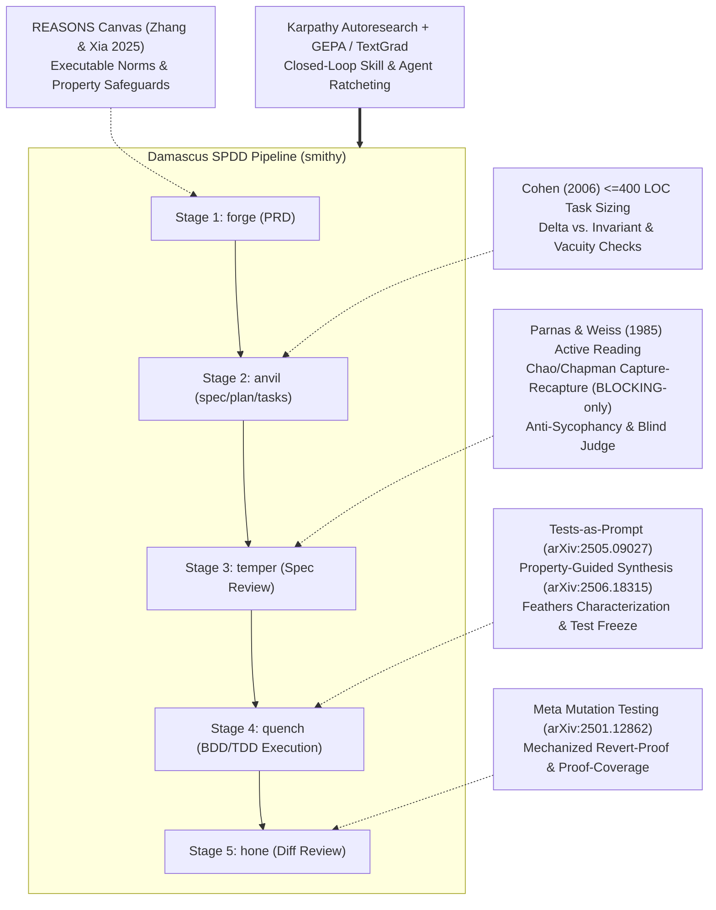

# Damascus Research & Science Reference Corpus

This directory contains the scientific literature, empirical field analyses, and architectural blueprints underpinning the systematic review and improvement plan for **Damascus** ([`README.md`](../README.md)).

Damascus enforces a Specification-Driven Development (SPDD) pipeline (`forge → anvil → temper → quench → hone`, orchestrated by [`smithy`](../skills/smithy/SKILL.md)). Each stage relies on explicit verification mechanics rather than LLM self-assessment. The documents in this corpus synthesize external peer-reviewed research, industrial engineering studies, and empirical failure modes observed across Damascus consumer repositories.

---

## Corpus Index

| Reference Document | Core Research Domains | Primary Damascus Targets |
| :--- | :--- | :--- |
| [`karpathy-autoresearch.md`](karpathy-autoresearch.md) | Andrej Karpathy's `autoresearch` (2026); `program.md` agent directives; editable target vs. immutable `prepare.py` harness; fixed budget; scalar metric ratcheting; `results.tsv`; anti-Goodhart held-out evaluation | Meta-optimization harness for `skills/*/SKILL.md` & `agents/*.md`; in-pipeline autoresearch loops for [`temper`](../skills/temper/SKILL.md), [`quench`](../skills/quench/SKILL.md) `[HARD]` tasks, and `hone` |
| [`prompt-and-skill-optimization.md`](prompt-and-skill-optimization.md) | GEPA (*Reflective Prompt Evolution*, Agrawal et al., 2025); DSPy & MIPROv2 (Opsahl-Ong et al., 2024); TextGrad (*Automatic Differentiation via Text*, Yuksekgonul et al., 2024); Pareto frontier maintenance | Trace-driven evolution of [`skills/`](../skills) and [`agents/`](../agents) using `review.md` and `quench-log.md` execution traces |
| [`adversarial-review-and-llm-judges.md`](adversarial-review-and-llm-judges.md) | Multi-agent debate (Du et al., 2023; Liang et al., 2023); sycophancy & disagreement collapse (CONSENSAGENT, Free-MAD); blind judge protocols (Zheng et al., 2023); capture-recapture defect estimation (Lincoln-Petersen, Chapman, Chao); Parnas & Weiss (1985) active design reviews; Cohen (2006) inspection sizing | [`skills/temper/SKILL.md`](../skills/temper/SKILL.md) and `skills/hone/SKILL.md` critic independence, BLOCKING-only overlap stratification, blind judge evaluation, and fresh-critic rotation |
| [`tdd-mutation-and-property-testing.md`](tdd-mutation-and-property-testing.md) | Red-Amber-Green TDD & *Tests as Prompt* (Mathews & Nagappan, 2024/2025); Meta Mutation-Guided LLM Test Generation (*ACH*, Harman et al., 2025) & *AutoSD* (2025); Property-Based Testing (*PGS*, He et al., 2025); Characterization testing (Feathers, 2004); Mechanical Revert-Proofs | [`skills/quench/SKILL.md`](../skills/quench/SKILL.md), `skills/hone/SKILL.md`, [`agents/tdd-test-generator.md`](../agents/tdd-test-generator.md), [`agents/bdd-scenario-writer.md`](../agents/bdd-scenario-writer.md), and mechanized `revert-proof.py` / `proof-coverage.py` |
| [`spdd-and-requirements-engineering.md`](spdd-and-requirements-engineering.md) | Thoughtworks / Martin Fowler SPDD & REASONS Canvas (Zhang & Xia, 2025); GitHub `spec-kit`; Delta vs. Invariant classification; formal vacuity checking; M0 micro-temper; domain lens addenda | [`skills/forge/SKILL.md`](../skills/forge/SKILL.md), [`skills/anvil/SKILL.md`](../skills/anvil/SKILL.md), [`skills/temper/SKILL.md`](../skills/temper/SKILL.md), and [`skills/smithy/SKILL.md`](../skills/smithy/SKILL.md) |
| [`model-and-harness-agnosticism.md`](model-and-harness-agnosticism.md) | Vendor-neutral filesystem layout (`~/.local/bin`, `.damascus/`, `.agents/skills/`); unified cloud + local model execution (`damascus-agent-run` for Ollama, `llama.cpp`, vLLM, LM Studio, Claude, Gemini, Codex, OpenCode); small/local-model context ergonomics | [`install.sh`](../install.sh), `scripts/damascus-agent-run`, all [`skills/`](../skills) & [`agents/`](../agents), and `evals/run_eval.py` |

---

## Stage-to-Science Mapping Matrix

---

## Summary of Empirical Field Evidence on Disk

In addition to external literature, these references incorporate empirical observations from real Damascus pipeline executions inspected across sibling repositories:

1. **Unbounded `temper` Non-Convergence via NIT-Diluted Capture-Recapture (an auth library & an API service):**
   - In an auth library's review log, `temper` ran for **19 rounds** because computing the capture-recapture overlap ratio $m / D$ across `BLOCKING + NIT` findings caused lens-specific NITs (Completeness vs. Feasibility vs. Testability) to drive $m / D < 0.25$ even when `BLOCKING = 0`. An explicit owner ruling in Round 14 restricting $m / D$ to `BLOCKING` findings only was required to reach convergence.
   - In an API service's review log, 3 consecutive runs (15 rounds total) failed to converge at `B+` due to the same unstratified overlap formula.
2. **Unmechanized Revert-Proofs & Proof-Coverage Gaps (a PCB-design repo):**
   - Prose-only revert-proof rules in `hone` allowed subagents to claim revert-proofs without executing `git revert`, or to accept `INCONCLUSIVE` collection failures as `RED`, or to omit diff hunks from `cases.json`. Mechanizing `revert-proof.py` and `proof-coverage.py` eliminated these escapes.
3. **Unbound BDD Scenarios Passing Silently (a media service & an auth library):**
   - `.feature` files authored during `quench` passed `pytest` with 0 failures when step files lacked `scenarios("...")` bindings, because unbound Gherkin scenarios are not collected by `pytest` without an explicit scenario-count collection gate.
4. **Deprecated Library Idioms & Stack Lock-In in Dispatch Agents (a CRUD service):**
   - [`agents/fastapi-implementer.md`](../agents/fastapi-implementer.md) teaches Pydantic v1 (`@validator`, `class Config`), SQLAlchemy 1.x `db.query()`, and naive `datetime.utcnow()`, directly inducing regressions in a CRUD service's production-readiness review.
5. **Delta vs. Invariant Ambiguity & Vacuous SCs (an earlier analysis):**
   - Enterprise specification reviews in an earlier analysis demonstrated that specifications mixing changed behavior (`[DELTA]`) with preserved behavior (`[INVARIANT]`) or stating unfalsifiable Success Criteria require explicit tags and a mechanical vacuity check during `anvil` and `temper`.
