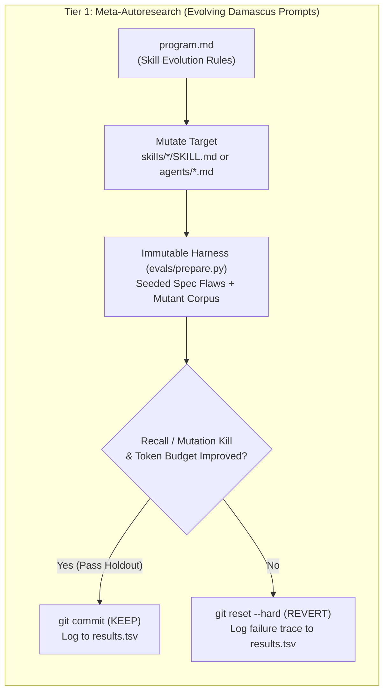

# Karpathy's `autoresearch` & Science-Based Agent Ratcheting for Damascus

## 1. Primary References

- **Karpathy, A. (2026).** *autoresearch: Autonomous AI research loops on a single GPU.* GitHub repository: `https://github.com/karpathy/autoresearch`.
- **Karpathy, A. (2026).** *"Software in the era of autonomous hill-climbing (`program.md`)."* Architectural notes accompanying `autoresearch`.
- **Goodhart, C. A. E. (1975) & Strathern, M. (1997).** *"Improving ratings: audit in the British University system."* *European Review*, 5(3), 305–321. ("When a measure becomes a target, it ceases to be a good measure.")

---

## 2. Core Architecture of Karpathy's `autoresearch`

Andrej Karpathy's `autoresearch` strips autonomous AI engineering down to the minimal structure required for genuine **empirical science** (hypothesis $\to$ controlled modification $\to$ fixed-budget experiment $\to$ objective evaluation $\to$ keep/revert ratchet).

Instead of trusting an LLM's self-reported confidence or allowing an agent to edit both the implementation and the grading rubric, `autoresearch` enforces **five structural invariants**:

### 2.1 Strict Separation of Responsibilities (3-File Topology)
| Component | Role in `autoresearch` | Mutability | Damascus Equivalent |
| :--- | :--- | :--- | :--- |
| **`program.md`** | High-level research directives, constraints, domain priors, and loop protocol authored by the human engineer. | Human-edited (outer loop) | [`skills/*/SKILL.md`](../skills/smithy/SKILL.md) & [`agents/*.md`](../agents/labcoat.md) |
| **`train.py`** | The single artifact under optimization (model architecture, optimizer, hyperparameters). | **Agent-editable** (inner loop) | Target code in `quench`, spec in `temper`, or `SKILL.md` in meta-autoresearch |
| **`prepare.py`** | Data loading, wall-clock enforcement, and evaluation metric computation (`val_bpb`). | **Strictly Read-Only / Immutable** | Frozen test suite, `revert-proof.py`, `proof-coverage.py`, and held-out benchmark |

### 2.2 Fixed Experimental Budget
Every experiment in `autoresearch` runs under a strict, identical wall-clock budget (e.g., $300\text{ s}$ of training execution). Fixing the resource budget makes experiments directly comparable and prevents an agent from "improving" the metric simply by consuming $10\times$ more compute, tokens, or review rounds.

### 2.3 Single Scalar Objective Metric (No Subjective Grading)
`autoresearch` evaluates each candidate strictly on a deterministic scalar metric (`val_bpb` — validation bits per byte, vocabulary-size independent). There is no subjective LLM judge in the inner keep/revert decision unless that judge is calibrated against ground-truth seeded defects.

### 2.4 Autonomous Git Keep/Revert Ratchet
Each iteration follows a strict state machine:
1. Formulate a falsifiable hypothesis based on prior runs in `results.tsv` and current code state.
2. Commit candidate modification to a working branch.
3. Execute the immutable harness (`prepare.py`).
4. Compare the resulting metric $M_{\text{new}}$ against the incumbent best $M_{\text{best}}$ (subject to simplicity regularizer $\epsilon$):
   - If $M_{\text{new}}$ improves on $M_{\text{best}}$ (or achieves equal score with fewer lines of code / lower complexity), **advance the branch pointer (KEEP)**.
   - Otherwise, **`git reset --hard` to the incumbent commit (REVERT)**.
5. Append the structured outcome (`commit`, `metric`, `delta`, `resource_cost`, `status`, `hypothesis_summary`) to `results.tsv` (untracked so it survives `git reset --hard`).

### 2.5 Simplicity Regularization & Anti-Goodhart Held-Out Validation
Karpathy embeds an explicit **Occam's Razor prior** inside `program.md`:
- *"A $0.001$ improvement that adds 20 lines of hacky complexity is NOT worth it. Conversely, deleting code while keeping the metric flat or slightly better IS a strong win."*
- When `autoresearch` is applied to software or prompt engineering, optimizing solely against an visible test suite invites **reward hacking** (Goodhart's Law): the agent overfits to visible test cases or exploits edge cases in the evaluator. The scientific remedy is a **two-split evaluation harness**:
  1. **Visible Dev Harness ($E_{\text{dev}}$):** Used by the agent during the inner loop to guide search.
  2. **Held-Out Lockbox Suite ($E_{\text{holdout}}$):** Hidden from the agent's read context and evaluated automatically before a commit is promoted to the ratcheted baseline.

---

## 3. Applying `autoresearch` to Damascus: Two-Tier Architecture

Damascus can harness `autoresearch` at two distinct levels:
1. **Tier 1 — Meta-Autoresearch (`evals/`):** Scientifically evolving Damascus's own `skills/*/SKILL.md` and `agents/*.md` prompts against a curated benchmark of seeded specification defects and code bugs.
2. **Tier 2 — In-Pipeline Autoresearch:** Embedding `autoresearch` ratchets directly inside `temper` (spec refutation), `quench` (`[HARD]` task optimization & mutation-score ratcheting), and `hone` (mechanized revert-proof ratcheting).

---

## 4. Tier 1 Blueprint: Meta-Autoresearch for Damascus Skills & Agents

Right now, changes to [`skills/temper/SKILL.md`](../skills/temper/SKILL.md), `skills/hone/SKILL.md`, [`skills/quench/SKILL.md`](../skills/quench/SKILL.md), or [`agents/tdd-test-generator.md`](../agents/tdd-test-generator.md) are validated only by [`tests/smoke.sh`](../tests/smoke.sh), which checks symlink creation (`install.sh`) and frontmatter presence—not whether the prompts actually catch more bugs or converge faster!

By adding an `autoresearch`-style evaluation harness under `evals/`, Damascus can turn prompt engineering into a reproducible experimental science:

### 4.1 Immutable Evaluation Harness (`evals/run_eval.py`)
Construct a read-only benchmark corpus derived from real defects found across Damascus consumer repos (an auth library, an API service, a CRUD service, a media service, a PCB-design repo):

1. **`evals/corpus/temper_seeded_specs/` (10–15 Specs with Known Ground-Truth Flaws):**
   - Each benchmark case takes a converged `A++` spec triplet (`spec.md`, `plan.md`, `tasks.md`) and injects $k \in [3, 5]$ controlled, documented `BLOCKING` defects across the three orthogonal lenses:
     - *Completeness:* Missing FR-to-task mapping, unconfirmed `[ASSUMED]` marker, missing error/timeout behavior.
     - *Feasibility:* Phantom library API, task touching $>400$ lines / circular phase ordering, architectural violation.
     - *Testability:* Vacuous SC ("system is fast and secure"), untestable Safeguard, missing `[REFACTOR]` tag on behavior-modifying task.
   - Include **2 clean control specs** ($k = 0$ seeded defects) to measure the **False Positive Rate (FPR)** (whether `temper` hallucinates blocking defects or gets stuck at `B+` on clean specs).
2. **`evals/corpus/hone_seeded_diffs/` (10–15 Code Diffs with Seeded Mutants & Subtle Bugs):**
   - Real diffs with injected subtle bugs: timezone-naive vs. timezone-aware `datetime` comparison (a CRUD service, T014), unbound `pytest-bdd` `.feature` file (a media service, T013), missing error-path rollback, and subtle boundary off-by-one mutations.

### 4.2 Scalar Objective Function ($J_{\text{skill}}$)
For any candidate edit to `skills/temper/SKILL.md` or `skills/hone/SKILL.md`, the immutable harness runs the critic panel under a fixed token/time budget ($B_{\text{max}}$) and computes:

$$J_{\text{skill}} = 0.50 \cdot F_1(\text{Seeded BLOCKING Defects}) + 0.25 \cdot (1 - \text{FPR}_{\text{clean}}) + 0.15 \cdot \text{Pass@Round1} - 0.10 \cdot \left(\frac{\text{PromptLines}}{200} + \frac{\text{TokensUsed}}{B_{\text{max}}}\right)$$

Where:
- $F_1(\text{Seeded BLOCKING Defects})$ measures precision and recall on the known injected bugs.
- $1 - \text{FPR}_{\text{clean}}$ penalizes critics that manufacture phantom `BLOCKING` issues on clean specs (preventing the 19-round non-convergence seen in an auth library).
- $\text{PromptLines}$ enforces Karpathy's simplicity regularizer (rewarding shorter, sharper `SKILL.md` files over bloated 700-line manuals).

---

## 5. Tier 2 Blueprint: In-Pipeline `autoresearch` Inside Damascus Stages

### 5.1 Upgrading `quench`'s `[HARD]` Task Loop from 1-Shot "Sample-and-Select" to Bounded `autoresearch`
In commit `6c92bf1`, `quench` introduced a `Sample-and-select for [HARD] tasks` protocol that dispatches 2–3 parallel candidate designs and picks one in a single shot.
While parallel sampling explores breadth, Karpathy's `autoresearch` demonstrates that **iterative ratcheting with `results.tsv` memory** outperforms 1-shot parallel sampling on algorithmic, numerical, performance, or layout tasks:
- **When a task is tagged `[HARD]` and has a quantifiable gate metric** (e.g., latency in $\text{ms}$, memory footprint in $\text{MB}$, routing completion percentage, or mutation kill score):
  1. Freeze the task's acceptance tests and benchmark script as the **read-only harness**.
  2. Run a bounded $N$-iteration (e.g., $N \le 5$, budget $\le 120\text{ s}$ per run) `autoresearch` loop via [`agents/labcoat.md`](../agents/labcoat.md).
  3. Record each hypothesis, commit SHA, metric value, and `KEEP`/`REVERT` status in `specs/NNN-<slug>/autoresearch-<task-id>.tsv`.

### 5.2 Mechanized Test Freeze as `prepare.py` Enforcer in `quench`
In `autoresearch`, the agent is structurally prevented from editing `prepare.py`. In `quench`, the Amber $\to$ Green rule states: *"Do NOT modify tests during Green."* However, this rule is currently enforced only by prompt instruction and post-hoc prose logging in `quench-log.md`.
- **Autoresearch Upgrade:** Mechanize a pre-Green snapshot hash (`sha256sum tests/** > .damascus/amber-test-lock.sha256` or `git diff --exit-code tests/`) that runs as a deterministic gate script before any Green commit succeeds. If an implementing subagent alters a test file during Green without unlocking via an logged `AMBER-AMEND`, the gate fails automatically.

### 5.3 Mutation-Guided `autoresearch` Loop in `quench` / `hone`
During `quench` (after Green) or `hone`, an automated test-hardening ratchet can run against the task's changed source files:
1. **Immutable Harness:** Run a fast mutation testing tool (e.g., `mutmut` / `cosmic-ray` for Python, `cargo-mutants` for Rust, or LLM-generated syntactic mutants per Meta's ACH paper) on the lines touched by the task diff.
2. **Editable Target:** Only the test files (`tests/unit/`, `tests/property/`). Production code is locked read-only.
3. **Scalar Metric:** Mutation Kill Score $S_{\text{mut}} = \frac{\text{Killed Mutants}}{\text{Total Non-Equivalent Mutants}}$.
4. **Keep/Revert Rule:** A candidate test addition is **KEPT** only if $\Delta S_{\text{mut}} > 0$ and execution time remains within budget; redundant tests with $\Delta S_{\text{mut}} = 0$ are **REVERTED** automatically.
