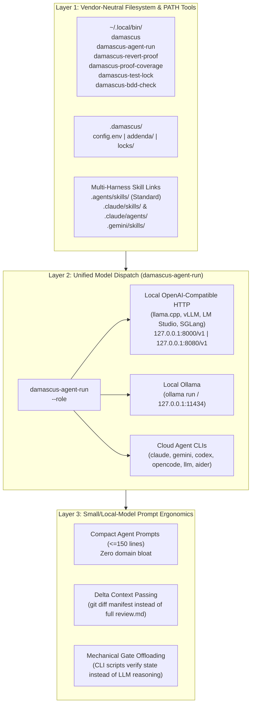

# Model & Harness Agnosticism: Cloud CLIs, Local Open-Weight Models, and Vendor-Neutral Layout

## 1. Design Problem: Eliminating Vendor Lock-In (`.claude/` & Hardcoded CLIs)

In its initial iterations (`5bc1e99` and `f77d070`), Damascus exhibited three forms of vendor and model coupling:

1. **Filesystem Coupling to `.claude/`:**
   - [`install.sh`](../install.sh) only created symlinks inside `.claude/skills/` and `.claude/agents/`.
   - [`skills/anvil/SKILL.md`](../skills/anvil/SKILL.md#L91) resolved the Damascus root by running `readlink` on `.claude/skills/anvil`.
   - Non-Claude harnesses (OpenAI Codex CLI, Google Gemini CLI / Antigravity, OpenCode, Aider, Goose, Cursor, Windsurf, or local shell scripts) do not read `.claude/agents/` by default.
2. **Critic Dispatch Coupling to Three Proprietary Cloud CLIs:**
   - [`skills/temper/SKILL.md`](../skills/temper/SKILL.md) and `skills/hone/SKILL.md` hardcoded `command -v claude codex gemini` and instructed the orchestrator to shell out specifically to `codex exec` or `gemini -p`.
   - Any developer running **local open-weight models** (via Ollama, `llama.cpp` / `llama-server`, vLLM, SGLang, LM Studio, or LocalAI) had no supported path to run the 3-critic panel or implementer dispatches.
3. **Prompt & Context Assumptions Tuned Only for 200k-Token Frontier Cloud Models:**
   - [`agents/bdd-scenario-writer.md`](../agents/bdd-scenario-writer.md), [`agents/tdd-test-generator.md`](../agents/tdd-test-generator.md), [`agents/playwright-e2e-tester.md`](../agents/playwright-e2e-tester.md), and [`agents/fastapi-implementer.md`](../agents/fastapi-implementer.md) each ranged from **570 to 755 lines** (~$4\,500\text{–}6\,000$ tokens of static system prompt before any task context is added).
   - For local models (e.g., 7B–32B parameter models such as Qwen2.5-Coder, DeepSeek-R1-Distill, Gemma, or Llama running under $8\,\text{k}\text{–}32\,\text{k}$ KV-cache budgets), a $6\,000$-token system prompt combined with a $4\,000$-token `review.md` causes severe **lost-in-the-middle attention degradation** (Liu et al., 2024, *"Lost in the Middle: How Language Models Use Long Contexts"*, *TACL*, `arXiv:2307.03172`).

---

## 2. Three-Layer Architecture for Universal Model & Harness Agnosticism



### 2.1 Layer 1: Vendor-Neutral Paths (`~/.local/bin`, `.damascus/`, and `.agents/`)
1. **Executable Verification & Dispatch Scripts on `PATH` (`~/.local/bin/`):**
   - Never bury executable scripts inside `.claude/scripts/`.
   - Source scripts live in `/workspace/scripts/` inside the Damascus repository and are symlinked into `~/.local/bin/` (`$BIN_DIR`) by [`install.sh`](../install.sh):
     - `damascus` — Installer & repo bootstrapper
     - `damascus-agent-run` — Model-agnostic prompt runner (local HTTP, Ollama, and cloud CLIs)
     - `damascus-revert-proof` — Worktree-isolated tri-state (`RED`/`GREEN`/`INCONCLUSIVE`) revert-proof verifier
     - `damascus-proof-coverage` — Diff hunk coverage verifier
     - `damascus-test-lock` — SHA-256 Amber test freeze verifier
     - `damascus-bdd-check` — Gherkin `.feature` to test-runner collection parity gate
   - Because these tools live on `PATH`, **any** model or harness with shell execution can invoke `damascus-revert-proof` directly without knowing where Damascus or `.claude` is installed.
2. **Environment Variable & Portable Root Discovery (`DAMASCUS_HOME`):**
   - Instead of `readlink -f .claude/skills/anvil` (which breaks both on macOS BSD userland and on non-Claude harnesses), skills locate Damascus templates via `$(damascus --print-root)` or `$DAMASCUS_HOME`.
3. **Project-Local State in `.damascus/` (Never `.claude/`):**
   - Host-repository configuration, domain addenda, and Amber test-lock manifests live under `.damascus/`:
     - `.damascus/addenda/<stage>.md` — Domain-specific stage rules and extra critic lenses
     - `.damascus/models.conf` — Optional per-repo model/provider routing table
     - `.damascus/locks/amber-tests.sha256` — Mechanized test freeze state
4. **Multi-Harness Skill & Agent Symlinking in `install.sh`:**
   - `install.sh` links skills into `.agents/skills/` (the emerging cross-vendor standard supported by OpenCode, Codex, Amp, and Antigravity), `.claude/skills/`, and `.gemini/skills/` (when `.gemini` exists or `--all-harnesses` is passed).

---

### 2.2 Layer 2: `damascus-agent-run` — Unified Cloud + Local Model Adapter

To make `temper`, `hone`, `quench`, and `evals/run_eval.py` completely model-agnostic, Damascus provides `scripts/damascus-agent-run`, a zero-dependency script (using only POSIX `sh` / standard-library Python 3 `urllib.request`) that abstracts model invocation behind a single interface:

```bash
# Discover all available local and cloud backends:
damascus-agent-run --probe

# Dispatch a critic or task to a specific backend or role:
damascus-agent-run --role critic-a --system-file skills/temper/critic-a.md --input-file specs/001/bundle.md
```

#### Supported Backends (Auto-Probed in Priority Order or Configured via `.damascus/models.conf` / Env Vars)
1. **Local OpenAI-Compatible Endpoints (`openai-compat`):**
   - Works out-of-the-box with **`llama.cpp` (`llama-server`)**, **vLLM**, **SGLang**, **LM Studio**, **LocalAI**, **Jan**, and **mlx_lm.server**.
   - Auto-probes `DAMASCUS_LOCAL_URL` (and standard local ports `http://127.0.0.1:8080/v1/models`, `http://127.0.0.1:8000/v1/models`, `http://127.0.0.1:1234/v1/models`).
2. **Local Ollama (`ollama`):**
   - Auto-probes `command -v ollama` and `http://127.0.0.1:11434/api/tags`.
   - Dispatches via `/api/chat` with configurable context window (`num_ctx`, default `32768`) and temperature (`0.2` for critics/judge).
3. **Cloud & Open-Source CLI Harnesses:**
   - `claude` (`claude -p`)
   - `gemini` (`gemini -p`)
   - `codex` (`codex exec`)
   - `opencode` (`opencode run`)
   - `llm` (Simon Willison's `llm` CLI, which itself bridges 50+ local and remote models)
   - Custom shell template via `DAMASCUS_CUSTOM_CMD`.

#### Built-In Blind Anonymization for `temper` and `hone`
When `damascus-agent-run` returns a critic output to the Judge, it strips provider metadata and headers, tagging the output solely as `Critic A (Completeness)`, `Critic B (Feasibility)`, or `Critic C (Testability)`. Whether Critic B ran on a local `qwen2.5-coder:32b` via Ollama, `llama-server` on port 8080, or `gemini` in the cloud, the Judge sees an identical, anonymized markdown structure.

---

### 2.3 Layer 3: Local-Model Ergonomics (Small Context & Structured Reasoning)

Local open-weight models (7B–32B parameters) have smaller effective context windows and lower tolerance for competing instructions than frontier cloud models. Three structural rules ensure Damascus works reliably on local models:

1. **Strict $\le 150$-Line Budget per Agent Prompt (`agents/*.md`):**
   - Removing the 500+ lines of hardcoded cybersecurity STIX examples cuts prompt overhead from ~$5\,500$ tokens to $< 800$ tokens, leaving $>90\%$ of a $16\,\text{k}\text{–}32\,\text{k}$ local KV cache available for the actual specification and code under review.
2. **Bounded Diff Slices ($\le 400$ Lines) & Delta Context Passing:**
   - Instead of passing the entire cumulative `review.md` from Rounds $1 \dots r-1$ into Round $r$, pass only the current artifact (`spec.md`/`plan.md`/`tasks.md` or current diff slice) plus the compact **Round $r-1$ Fix Diff Manifest**.
3. **Offloading State Verification from Prompt Reasoning to Deterministic Scripts:**
   - Rather than asking a local 14B model to mentally track whether tests were modified during Green or whether every diff hunk has a revert-proof, the orchestrator runs `damascus-test-lock`, `damascus-bdd-check`, `damascus-revert-proof`, and `damascus-proof-coverage`, feeding back crisp 1-line pass/fail results.

---

## 3. Personal Field-Validation Repositories Without Breaking External Users

The author validates Damascus against 10 personal sibling repositories (kept private) for field validation and trace harvesting (`evals/`). External users only have the public submodules (`vendor/superpowers`, `vendor/spec-kit`), so nothing in Damascus may depend on those repositories.

**Considered and not published:** Git can register such repositories as optional submodules with `update = none` and `ignore = all` in `.gitmodules` (`gitmodules(5)`). `git clone --recurse-submodules` and `git submodule update --init --recursive` then skip them without a network attempt (exit `0`), and `ignore = all` keeps experiments inside them out of the parent's `git status`. This repository does not do that: it would publish the private repositories' names. The author keeps them as local, untracked clones under `vendor/`, hidden from `git status` with `.git/info/exclude`.

Consumers of the field data are run by pointing the tools at a directory: `./install.sh upgrade-consumers --scan-dir vendor`.
