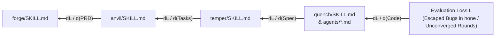

# Automated Prompt & Skill Optimization Science (GEPA, DSPy/MIPROv2, TextGrad)

## 1. Primary References

1. **Agrawal, L. A., Tan, S., Soylu, D., Ziems, N., Khare, R., Opsahl-Ong, K., Singhvi, A., Shandilya, H., Ryan, M. J., Jiang, M., Potts, C., Sen, K., Dimakis, A. G., Stoica, I., Klein, D., Zaharia, M., & Khattab, O. (2025).** *"GEPA: Reflective Prompt Evolution Can Outperform Reinforcement Learning."* arXiv preprint `arXiv:2507.19457` (Integrated into DSPy as `dspy.GEPA`).
2. **Opsahl-Ong, K., Ryan, M. J., Purtell, J., Broman, D., Potts, C., Zaharia, M., & Khattab, O. (2024).** *"Optimizing Instructions and Demonstrations for Multi-Stage Language Model Programs."* In *Proceedings of EMNLP 2024*, `arXiv:2406.11695` (MIPROv2).
3. **Yuksekgonul, M., Bianchi, F., Boen, J., Liu, S., Huang, Z., Guestrin, C., & Zou, J. (2024/2025).** *"TextGrad: Automatic 'Differentiation' via Text."* *Nature* / `arXiv:2406.07496`.
4. **Khattab, O., Singhvi, A., Maheshwari, P., Zhang, Z., Santhanam, K., Vardhamanan, S., Haq, S., Sharma, A., Joshi, T. T., Moazam, H., Miller, H., Zaharia, M., & Potts, C. (2024).** *"DSPy: Compiling Declarative Language Model Calls into Self-Improving Pipelines."* In *ICLR 2024*, `arXiv:2310.03714`.

---

## 2. Why Scalar-Only Optimization Fails on Multi-Stage Agent Pipelines

In Karpathy's original `autoresearch` for neural network training (`train.py`), the search space consists of code/hyperparameter mutations and the feedback signal is a single scalar (`val_bpb`) plus a training log.

When optimizing **natural-language agent skills** (`skills/*/SKILL.md` and `agents/*.md`) across a 5-stage pipeline (`forge → anvil → temper → quench → hone`), two bottlenecks emerge if we rely solely on blind random mutations and scalar scores:

1. **Credit Assignment Bottleneck Across Stages:** If a feature fails in Stage 5 (`hone`), was the root cause a vague Safeguard in `forge`, an oversized task in `anvil`, a missed `Testability` flaw in `temper`, or a weak Amber test in `quench`? A scalar end-to-end score cannot localize which stage skill needs updating.
2. **Rich Diagnostic Signal in Execution Traces:** Unlike float32 gradient descent, LLM pipeline runs emit complete, human- and machine-readable diagnostic artifacts: `review.md`, `quench-log.md`, `cases.json`, and test failure tracebacks. Ignoring these traces throws away 99% of the information generated during an evaluation rollout.

Recent breakthroughs in automated prompt optimization—specifically **GEPA** (2025), **TextGrad** (2024), and **MIPROv2** (2024)—solve both problems and pair naturally with Karpathy's `autoresearch` keep/revert ratchet.

---

## 3. Core Techniques & Mathematical Foundations

### 3.1 GEPA: Reflective Prompt Evolution + Instance-Wise Pareto Frontier
Agrawal et al. (2025, `arXiv:2507.19457`) demonstrate that **Genetic-Pareto Reflective Evolution (GEPA)** outperforms Group Relative Policy Optimization (GRPO / RL) by up to $10\text{–}20\%$ while requiring **$35\times$ fewer rollouts** and producing **up to $9.2\times$ shorter prompts**.

GEPA introduces two mechanisms directly applicable to evolving Damascus skills:

1. **Trace-Driven Reflective Mutation (Natural-Language Diagnostic Feedback):**
   - Instead of mutating a prompt blindly, GEPA samples full execution trajectories $\tau = (x, y_{\text{stage}_1}, \dots, y_{\text{stage}_k}, \text{feedback})$ where an agent failed or underperformed.
   - A reflection step inspects the exact trace (e.g., why `temper` Critic C missed an unbound `.feature` requirement, or why `temper` Judge capped a 0-BLOCKING round at `B+`) and synthesizes a targeted rule modification to the skill's `SKILL.md`.
2. **Instance-Wise Pareto Frontier Maintenance:**
   - Rather than keeping only a single global-average champion prompt (which often collapses into a conservative local optimum that solves easy cases and fails hard edge cases), GEPA maintains a **Pareto frontier of candidate prompts** across individual benchmark instances $i \in \{1, \dots, M\}$.
   - Prompt candidate $P_a$ dominates $P_b$ iff $\forall i, S(P_a, i) \ge S(P_b, i)$ and $\exists j, S(P_a, j) > S(P_b, j)$.
   - Once complementary specialist prompts are discovered on the frontier (e.g., one `temper` variant excels at catching concurrency/state defects, another excels at catching vacuous SCs), GEPA applies a **System-Aware Merge** operator to combine their winning instructions without prompt bloat.

### 3.2 TextGrad: Textual Backpropagation Through Multi-Agent Computation Graphs
Yuksekgonul et al. (2024, `arXiv:2406.07496`) formalize multi-stage LLM workflows as computation graphs where variables are natural-language artifacts (`PRD`, `spec.md`, `plan.md`, `tasks.md`, `review.md`, `code diff`) and parameterized edges are system prompts (`SKILL.md`, `agents/*.md`).

- When a downstream failure occurs in Stage 5 (`hone`) or in production readiness reviews (such as those documented in a CRUD service's production-readiness review), **Textual Backpropagation** asks:
  1. *Gradient w.r.t. Stage 4 (`quench` / `agents/`):* What instruction in [`agents/fastapi-implementer.md`](../agents/fastapi-implementer.md) or [`skills/quench/SKILL.md`](../skills/quench/SKILL.md) permitted this defect to pass Green?
  2. *Gradient w.r.t. Stage 3 (`temper`):* Which active check in [`skills/temper/SKILL.md`](../skills/temper/SKILL.md) should have flagged the underspecified requirement before coding began?
  3. *Gradient w.r.t. Stage 2 (`anvil`) / Stage 1 (`forge`):* What structural slot in `tasks.md` or the REASONS Canvas was missing?

This backward credit assignment turns every real bug found in a consumer repo into a deterministic improvement across the upstream Damascus stages.

### 3.3 DSPy & MIPROv2: Instruction vs. Few-Shot Demonstration Trade-offs
Opsahl-Ong et al. (2024, `arXiv:2406.11695`) show two critical findings about prompt structure:
1. **Concrete Few-Shot Examples Outweigh Long Abstract Prose, Except When Domain-Biased:**
   - Bootstrapping concise, canonical input-output demonstrations significantly improves reliability on structured tasks (like writing Gherkin scenarios or `review.md` finding blocks).
   - **Critical Warning for Damascus:** When few-shot examples are hardcoded to a narrow domain (e.g., the 500+ lines of MITRE ATT&CK STIX `T1059.001` cybersecurity examples currently hardcoded across [`agents/bdd-scenario-writer.md`](../agents/bdd-scenario-writer.md), [`agents/tdd-test-generator.md`](../agents/tdd-test-generator.md), and [`agents/fastapi-implementer.md`](../agents/fastapi-implementer.md)), they **contaminate unrelated domains** and waste $4\,000\text{–}6\,000$ context tokens per subagent invocation!
2. **Modular Signatures + Compact Domain-Agnostic Exemplars:**
   - Replace 600-line domain-specific tutorials inside `agents/*.md` with concise ($\le 150$-line) operational contracts: input signature, strict Red-Amber-Green verification protocol, anti-rationalization checklist, and 1 minimal domain-neutral exemplar (<30 lines).

---

## 4. Concrete Application to Damascus: Trace-Driven Skill Evolution Loop

We can combine **Karpathy's `autoresearch` keep/revert ratchet** with **GEPA/TextGrad trace reflection** to create a closed-loop **Damascus Skill Evolution Protocol**:

1. **Harvest Field Traces (`evals/harvest_traces.py`):**
   - Extract real historical `review.md` and `quench-log.md` files from consumer repositories (an auth library, an API service, a CRUD service, a media service, a PCB-design repo, an earlier analysis).
2. **Compute Textual Gradients (Post-Mortem Reflection):**
   - For every round where `temper` or `hone` either (a) missed a bug that surfaced later, (b) generated false-positive churn ($>3$ rounds without new `BLOCKING` defects), or (c) suffered a subagent protocol escape (e.g., modifying tests in Green, skipping revert-proofs, writing unbound `.feature` files), generate a structured **TextGrad Diagnosis** pinpointing the exact line range in `skills/*/SKILL.md` or `agents/*.md`.
3. **Propose Minimal Skill Edit & Ratchet via `autoresearch`:**
   - Apply the candidate edit to `skills/*/SKILL.md` or `agents/*.md`.
   - Run the immutable evaluation harness (`tests/smoke.sh` + `evals/run_eval.py` against the seeded defect corpus).
   - Keep the commit only if defect recall/precision improves and total prompt token count does not bloat beyond the simplicity budget.
